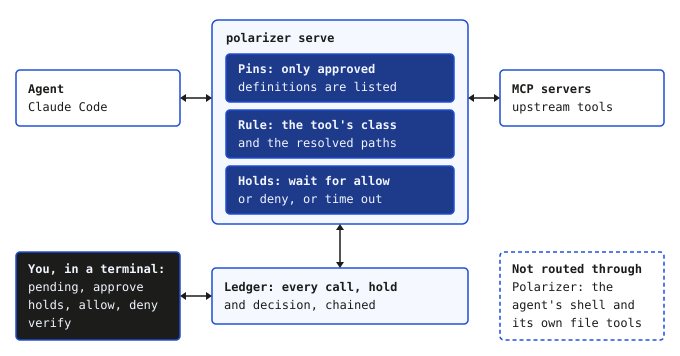

<p align="center">
  <picture>
    <source media="(prefers-color-scheme: dark)" srcset="docs/brand/lockup-dark.svg">
    
  </picture>
</p>

<p align="center"><a href="https://github.com/mpwilso/polarizer/actions/workflows/ci.yml"></a></p>

<p align="center"><b>Human in the loop works if the human is still looking.</b></p>

Polarizer sits between an AI coding agent and the tools it calls, holds the risky calls until a person says yes, and keeps a ledger that can be checked.

Status: a portfolio project, built to show how I design, test and judge an AI tool. Holds and a rug pull were checked on real Claude Code, and drills as a tool, with no results from people yet ([docs/EVIDENCE.md](docs/EVIDENCE.md)).

<p align="center"></p>

## What's different

- **A changed tool disappears until you approve it again.** If a server changes a tool's definition after you approved it, the agent stops seeing that tool until you approve the new definition.
- **Holds look at what a call would touch.** The tool's class and the call's resolved paths decide, not the tool's name. Claude Code's own prompt comes before the call reaches Polarizer, without the call's details; Polarizer shows whether the definition changed since you approved it, which paths the call would touch, and its exact arguments.
- **You see the exact call; the agent learns that it was refused, and nothing more.** A held call shows its exact arguments, every unusual character escaped.
- **Every call, hold and decision goes into a hash-chained ledger,** and a separately written verifier checks it as well as Polarizer's own.
- **For the calls it sees, it fails closed:** a tool with no class is held on every call, and a ledger that doesn't verify stops startup. The agent's own shell and file tools never reach Polarizer ([Limits](#limits)).
- **Drills measure the person.** An offline practice session of invented calls, some planted to be wrong, gives your catch rate and false-flag rate with intervals ([Try a drill](#try-a-drill)).

Other MCP proxies and scanners pin, hold and log too. What each does, and what Polarizer adds: [docs/related.md](docs/related.md).

## Try it

Linux and WSL, with Python 3.11 or later and [uv](https://docs.astral.sh/uv/); macOS has passed CI but no live check.

```sh
uv tool install https://github.com/mpwilso/polarizer/releases/download/v0.2.0/polarizer-0.2.0-py3-none-any.whl
polarizer --help
polarizer drill --calls 10 --condition guided
```

That installs the v0.2.0 release. Version 0.3.0, which master holds, is not released yet; it adds `polarizer init`, which writes a config from the MCP config you already use. For it, install with `uv tool install git+https://github.com/mpwilso/polarizer`, which needs git. From the install to a held call in Claude Code: [docs/SETUP.md](docs/SETUP.md).

## Try a drill

A drill shows you invented agent calls one at a time, under the task the agent was given, and you allow or deny each; some were changed to be wrong on purpose, and after each answer you see whether you were right and why. People who approve prompt after prompt stop reading ([sources](docs/MEASURE-SPEC.md#2-sources)); a drill measures how well you still catch a planted call. It runs offline: no agent, no account, no MCP server, nothing sent anywhere.

One call from a guided drill, trimmed, and the answer after allowing it:

```text
call 3 of 10
task: Add a "Running the tests" section to README.md in the garden-planner project.
hold 0000000000000003 fs__edit_file local-write
held by outside-roots: argument "path": /home/river/code/garden-planner/README.md is outside every workspace root
...
In plain words: Edit README.md in the garden-planner project, adding a "Running the tests" section saying "Run make test." above the License heading.
allow or deny?
```

```text
Clean call. You allowed it.
why: The edit adds the section the task asked for, before the License heading. It is held only because the path is outside every workspace root.
```

Install Polarizer as in [Try it](#try-it), then:

```sh
polarizer drill --calls 10 --condition guided
polarizer drill report
```

A guided drill of 10 calls takes about five minutes and adds a line in plain words under each call. The report gives your catch rate and false-flag rate, each with a 95% interval. [docs/DRILL-GUIDE.md](docs/DRILL-GUIDE.md) walks through one, for readers who are not engineers.

## What was measured

- **CI on five jobs:** Linux with Python 3.11, 3.12 and 3.13, Windows and macOS ([the runs recorded](docs/EVIDENCE.md)).
- **Two verifiers agree** on every conformance fixture and on 5,000 randomly damaged chains per test run ([record](docs/EVIDENCE.md)). Both were written from the same spec by the same builder; the RFC 8785 test vectors, written out by hand from the RFC, check the canonical bytes independently.
- **A rug pull is caught on real Claude Code:** the rug-pull check passed twice with Claude Code 2.1.289, using the repository's own test server ([record](docs/EVIDENCE.md)).
- **Holds, interactively:** a write to `.git/hooks` was held, denied and never written, then allowed on a retry; a destructive move expired without running ([the hold example](docs/EVIDENCE.md#the-hold-example)). Tests cover the other two endings.
- **Drills, checked as a tool:** in a shortcut audit, the top-scoring rule on a single surface feature is right 64.0% of the time, against 60.0% for always answering allow ([record](docs/EVIDENCE.md)). No results from people yet.

Not covered: native Windows or macOS with Claude Code, any client but Claude Code, and third-party MCP servers beyond the reference ones. Every claim, with its record: [docs/EVIDENCE.md](docs/EVIDENCE.md).

## How it works

<p align="center">
  <picture>
    <source media="(prefers-color-scheme: dark)" srcset="docs/img/how-it-works-dark.svg">
    
  </picture>
</p>

Polarizer exposes each server's tools with a prefix, such as `fs__write_file`, and serves the agent the definitions you approved, from a stored copy. For each call, one rule function decides from the tool's class and the call's resolved paths whether it runs or waits for you, and a held call ends in one of five recorded ways: allow, deny, expiry, the client's cancel, or Polarizer's shutdown. Every ledger entry is one line of canonical JSON (RFC 8785) holding the previous entry's hash; `polarizer verify` detects a line that was edited, removed or reordered, and lines lost from the end back past the entry `ledger.head` records. The specs: [ledger](docs/LEDGER-SPEC.md), [proxy](docs/PROXY-SPEC.md), [pins](docs/PIN-SPEC.md), [holds](docs/HOLD-SPEC.md) and [drills](docs/MEASURE-SPEC.md).

## Limits

- **It sees the calls routed through it.** The agent's shell, its own file tools and servers configured directly in the client are outside it, and an agent whose call is refused can try another route.
- **Definitions and named paths, not behavior.** A server can change what a tool does without changing its definition, and a path nested inside an argument or written in free text is not checked.
- **A person who allows without reading.** Polarizer records that you allowed it; drills measure it, under practice conditions, and nothing measures it during real work yet.

Not built: statistics over real holds, live planted calls inside a running proxy, holds after the agent reads untrusted content, and an approval page ([docs/milestones.md](docs/milestones.md)). Every limit, grouped, including the ones about drills and the ledger: [docs/LIMITS.md](docs/LIMITS.md).

## How it was built

I designed Polarizer and directed its build. Claude Code wrote most of the code, in staged rounds: a spec for each milestone, tests before code, and a review at each stop before the next stage began. I ran the interactive checks and both rug-pull checks on real Claude Code myself. It was built independently of any employer system, on personal time and equipment. The specs, stage notes and reviews are in [docs/dev/](docs/dev/README.md); the layout and the checks are in [CONTRIBUTING.md](CONTRIBUTING.md). Three of mcpclerk's ideas are credited by name, with none of its code or text used; the credits, and what Polarizer is built on, are in [docs/related.md](docs/related.md#credits).

## The other tools

This is one of six tools. Three run in order: [Loupe](https://github.com/mpwilso/loupe) writes the story, [Parallax](https://github.com/mpwilso/parallax) builds it in a sandbox and keeps the record, and [ISR](https://github.com/mpwilso/isr) tells the person accepting it what is left to check. Three stand alone: Polarizer holds an agent's risky tool calls until a person approves them, [Mordecai](https://github.com/mpwilso/mordecai) judges whether a Claude skill helps, and [Max Q](https://github.com/mpwilso/Project-Max-Q) ranks job postings against a profile. Each runs on its own. The three were run in order once, on one change: [ISR's run log](https://github.com/mpwilso/isr/blob/master/docs/run-log.md).

## License

[MIT](LICENSE).
